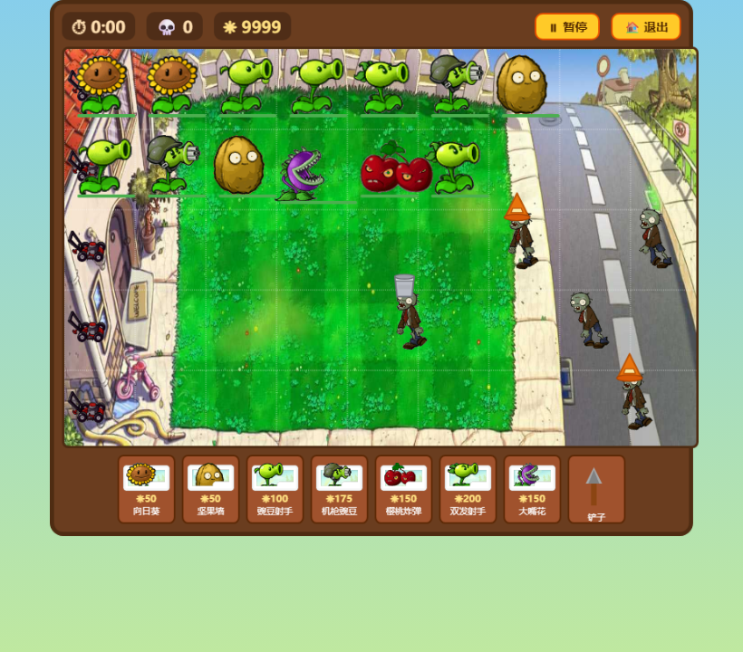

# 植物大战僵尸 · 学习融合版 (PvZ Edu)

> 一款面向小学课堂的教育改编游戏：在经典《植物大战僵尸》玩法中融入**拼音、英语、数学**练习——答题才能种植物、答题才能召唤僵尸，让孩子在玩游戏的过程中不知不觉完成知识点练习。

🎮 **在线试玩**：[https://thinheader.github.io/pvz-edu/](https://thinheader.github.io/pvz-edu/)



## ✨ 特性

- 🎮 **经典玩法完整保留**：5×9 格子草坪、阳光经济、7 种植物（向日葵/坚果墙/豌豆射手/双发射手/机枪豌豆/樱桃炸弹/大嘴花）、普通/路障/铁桶三种僵尸、小推车最后防线、逐帧原版风格动画
- 📚 **三种学习模式**：
  - **拼音**：声母/韵母/整体认读、拼读组合、三拼音节、标调规则、汉字注音，每题附拼读口诀
  - **英语**：90 个分级核心词汇，看中文拼英语 / 看英文选中文
  - **数学**：程序生成 1~6 年级题目——加减法 → 表内乘除 → 四则混合 → 小数 → 应用题
- 👥 **双人对战模式**：同屏分区答题，玩家 1 植物方、玩家 2 僵尸方，同题竞速、**先答对者获得战场优势**，连答对升级兵种，结束生成正确率+速度对比报告
- 🧑‍🏫 **教师功能**：JSON 自定义题库导入（自动与内置题库混合）、年级/僵尸速度/植物攻击力/对局时长可调、学习数据统计面板（自动标出薄弱知识点）
- 📴 **完全离线**：纯原生 HTML/JS/CSS，无任何依赖、无构建步骤，拷到教室电脑双击即玩
- 📱 **触屏友好**：答题框内置屏幕数字小键盘，平板/触屏大屏无需实体键盘

## 🚀 快速开始

无需安装任何东西：

```bash
# 方式一：直接下载
下载本仓库，双击 index.html 即可游玩

# 方式二：git clone
git clone https://github.com/YOUR_USERNAME/pvz-edu.git
cd pvz-edu
# 双击 index.html
```

推荐使用 Chrome / Edge 浏览器。教室大屏（触屏）同样支持。

## 🕹️ 玩法说明

### 单人生存模式
1. 点击格子 → 弹出对应科目的题目 → **答对才能种植物**（植物属性与题目难度挂钩）
2. 僵尸进攻时，完成拼读/拼写/计算任务才能触发植物攻击，答错植物暂时无法射击
3. 答错会显示正确答案并播放温和提示音效，不会惩罚
4. 每行有一辆小推车作最后防线；撑到倒计时结束即胜利

### 双人对战模式
- 左屏玩家 1（植物方）、右屏玩家 2（僵尸方），每轮同时出题竞速
- **先答对的一方获得 10 秒战场优势**，对方锁定 3 秒
- 答对自动召唤己方单位：植物方种植物（2 连击出双发射手、4 连击出机枪豌豆），僵尸方出僵尸（3 连击出路障僵尸、5 连击出铁桶僵尸）
- 结束后生成双方正确率、平均答题速度统计报告

## 📥 自定义题库导入

主菜单 →「题库管理」→ 选择科目 → 粘贴或导入 JSON 文件，格式：

```json
[
  { "q": "apple 的中文意思是？", "a": "苹果", "kp": "名词" },
  { "q": "b-à 拼出来是？", "a": "bà", "kp": "声母与单韵母" },
  { "q": "23 + 45 = ?", "a": "68", "kp": "100以内加法" }
]
```

| 字段 | 说明 |
|---|---|
| `q` | 题目文本（必填） |
| `a` | 正确答案（必填） |
| `kp` | 知识点标签，用于统计薄弱点（选填） |

导入后自动与内置题库混合出题，保存在浏览器本地，刷新不丢失。

## 📂 目录结构

```
pvz-edu/
├── index.html        # 游戏入口（双击运行）
├── css/style.css     # 界面样式
├── js/
│   ├── banks.js      # 内置题库数据（拼音表/词汇库/口诀）
│   ├── questions.js  # 出题引擎 + 学习统计存储
│   ├── audio.js      # Web Audio 合成音效（零素材文件）
│   ├── game.js       # 游戏引擎（战场/植物/僵尸/对战）
│   └── main.js       # 菜单/设置/题库管理/统计面板
├── images/           # 原版风格逐帧动画素材
└── docs/使用说明.md   # 面向教师的详细操作文档
```

## 🛠️ 技术要点

- 纯原生 HTML5 + DOM + CSS3，无框架、无构建、无外部请求
- 音效由 Web Audio API 实时合成，`js/audio.js` 可调音色音量
- 学习数据存 localStorage（沙箱环境自动降级为内存存储，游戏永不因存储问题卡死）
- 游戏主循环带异常防御，单帧异常不中断后续帧

## ⚠️ 版权说明

- **代码**：MIT 许可证，可自由使用、修改、二次开发
- **美术素材**：`images/` 下的植物/僵尸/卡片等原版风格素材来自开源学习项目（参考 [yangyunhe369/h5-game-plantsVSzombies](https://github.com/yangyunhe369/h5-game-plantsVSzombies)），**仅限课堂教学等非商业教育用途，请勿用于商业发行**。Plants vs. Zombies 是 EA/PopCap 的商标，本项目与官方无关
- 路障/铁桶头饰（`hat_cone.svg`、`hat_bucket.svg`）为本项目原创绘制

## 🤝 贡献

欢迎提交 Issue 和 PR：新增题库（尤其是分年级词汇/知识点）、改进音效、适配更多分辨率等。

---

如果这个项目对您的课堂有帮助，欢迎点个 ⭐ Star！
